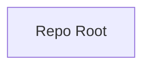

## Stack
Not a code project. No manifest files (package.json, go.mod, pyproject.toml, Cargo.toml) exist at repo root. No source files exist at all — only a `.git` directory and `README.md`.

## Directory map
| path | what lives there |
|---|---|
| `/` | repo root; contains only `README.md` and `.git/` |

## Diagram

## Component index
- [[Repo_Root]] — the only content in the repository (README.md)

## Entry points
- Dev: none — TODO: verify (no code present)
- Prod: none — TODO: verify (no code present)

## Conventions
- None observed — repository contains no source code to infer conventions from.

## Where things go
- To add source code, first establish a manifest (e.g. `pyproject.toml` for a Python package) at repo root.
- To document the project's purpose, expand `README.md` (currently a single line: "# Numpy").
- Re-run this documentation pass once actual code/structure exists.
